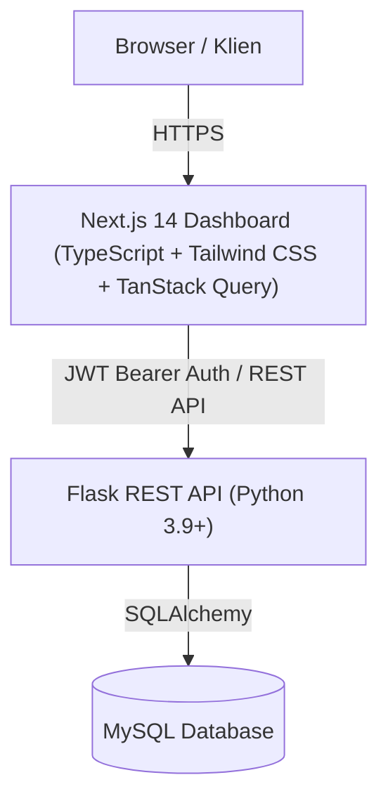

# ⚡ GeoEV Insight

> **Platform Dashboard Analisis Geospasial SPKLU & Home Charging Services (HCS)**  
> Dibangun khusus untuk kebutuhan internal analisis infrastruktur pengisian kendaraan listrik di wilayah **Jawa Timur dan Bali**.

---

## 📌 Ringkasan Proyek

**GeoEV Insight** adalah sistem dashboard dan manajemen data berbasis web modern yang menggabungkan visualisasi geospasial interaktif, perbandingan rasio kebutuhan fasilitas pengisian listrik, serta pengelolaan inventaris data yang aman dan teruji.

Sistem ini memadukan data inventaris titik **Stasiun Pengisian Kendaraan Listrik Umum (SPKLU)** di Jawa Timur dan Bali dengan catatan agregat pelanggan **Home Charging Services (HCS)** di Jawa Timur untuk memberikan rekomendasi berbasis data mengenai prioritas pengembangan infrastruktur energi kendaraan listrik.

---

## ✨ Fitur Utama

### 1. 🗺️ Peta & Infrastruktur Geospasial
- Peta interaktif berbasis Leaflet dengan marker titik SPKLU dan layer geospasial agregat HCS.
- Filter komprehensif berdasarkan **Provinsi**, **Pengelola (PLN / Non-PLN)**, **Kabupaten/Kota**, dan **Kategori Daya (Standar, Fast, Ultra Fast)**.
- Pencarian cepat nama atau ID SPKLU dengan *live dropdown*, navigasi cepat, dan fitur **Pusatkan Peta**.
- Panel ringkasan detail lokasi dengan rincian daya, unit charger, dan tipe konektor tanpa pemotongan tampilan tabel.

### 2. 📊 Distribusi Home Charging Services (HCS)
- Visualisasi grafik batang sebaran pemasangan fasilitas pengisian di rumah per kabupaten/kota di Jawa Timur.
- Analisis proporsi berdasarkan merek kendaraan listrik (Hyundai, Wuling, BYD, Chery, dll.).
- *Headline insight* otomatis mengenai konsentrasi adopsi kendaraan listrik tertinggi.

### 3. ⚖️ Perbandingan Wilayah
- Analisis rasio komparatif antara jumlah catatan HCS dan ketersediaan titik SPKLU per kabupaten/kota.
- Tabel komparasi lengkap dengan indikator status kesiapan wilayah.

### 4. 💡 Kajian Wilayah
- Rekomendasi otomatis **Top 5 Wilayah Prioritas Kajian** berdasarkan rasio HCS/SPKLU tertinggi.
- Daftar wilayah yang sudah memiliki adopsi HCS namun belum memiliki fasilitas SPKLU terpetakan.

### 5. 🛠️ Manajemen Data (Khusus Akun Admin)
Terletak pada menu **Manajemen Data** dengan tab navigasi lengkap:
- **Input SPKLU**: Formulir penambahan titik SPKLU baru lengkap beserta konfigurasi charger.
- **Edit SPKLU**: Modifikasi informasi SPKLU, rincian konektor, serta aktivasi/deaktivasi status (*soft delete*).
- **Input HCS**: Formulir manual penambahan catatan unit HCS baru per kabupaten/kota dan merek kendaraan dengan akumulasi otomatis.
- **Edit HCS**: Modifikasi atau penyesuaian (koreksi) total unit catatan HCS dengan tabel pencarian interaktif dan tombol edit langsung.
- **Upload Excel**: Unggah berkas Excel massal untuk data SPKLU dan catatan agregat HCS (mode *replace* atau *append*).
- **Riwayat Perubahan**: Jejak audit transparan mencatat waktu, akun pelaksana, jenis aksi, dataset, dan alasan perubahan.
- **Ekspor Data**: Ekspor inventaris ke format `.xlsx` (Excel) dan `.csv`.

### 6. 👥 Manajemen User (Khusus Admin & Super Admin)
- Pembuatan akun pengguna baru, pengaturan peran (*Super Admin*, *Admin*, *Viewer*), serta pengelolaan status akun aktif/nonaktif dan reset password.

---

## 🏗️ Arsitektur & Teknologi



### Stack Teknologi:
- **Frontend**: Next.js 14 (App Router), TypeScript, Tailwind CSS, TanStack React Query, Lucide Icons, Leaflet / React-Leaflet
- **Backend**: Python 3.9+, Flask REST API, SQLAlchemy, PyMySQL, Pandas, OpenPyXL, PyJWT
- **Database**: MySQL / MariaDB (Relational Database)

---

## 🔒 Keamanan & Perlindungan Data (*Privacy by Design*)

1. **Privasi Pelanggan HCS**:
   - Sistem **hanya menyimpan data agregat** (jumlah per wilayah dan merek kendaraan).
   - Data pribadi pelanggan seperti Nama, Nomor HP, Alamat Rumah, ID Pelanggan, atau Tarif **tidak disimpan** di database.
   - Titik lingkaran HCS pada peta menggunakan koordinat representatif pusat kabupaten/kota, bukan titik rumah pelanggan.

2. **Integritas Penulisan Data**:
   - **Optimistic Concurrency**: Mencegah penimpaan data tanpa sengaja (*stale-writes*) menggunakan token snapshot.
   - **Idempotency**: Setiap operasi write menggunakan `request_id` unik untuk mencegah duplikasi *double-submit*.
   - **Audit Trail**: Semua perubahan data terekam lengkap pada tabel `change_log`.

---

## 🚀 Panduan Menjalankan Aplikasi

### Prasyarat
- **Node.js** >= 18.x
- **Python** >= 3.9
- **MySQL / MariaDB** berjalan di port `3306`

### 1. Konfigurasi Database
Buat database di MySQL (misalnya `spklu_jatim`) dan jalankan skema tabel awal:
```sql
CREATE DATABASE spklu_jatim CHARACTER SET utf8mb4 COLLATE utf8mb4_unicode_ci;
```

### 2. Menjalankan Backend (Flask API)
```bash
# Pindah ke direktori backend
cd backend

# Buat virtual environment dan aktifkan
python -m venv .venv
# Windows:
.venv\Scripts\activate
# Linux/macOS:
# source .venv/bin/activate

# Install dependensi
pip install -r requirements.txt

# Salin konfigurasi environment
cp .env.example .env
# Sesuaikan DB_USER, DB_PASSWORD, DB_NAME, dan SECRET_KEY di .env

# Jalankan server API backend
python run.py
```
*Backend API akan berjalan di `http://127.0.0.1:5000`.*

### 3. Menjalankan Frontend (Next.js)
```bash
# Pindah ke direktori frontend
cd frontend

# Install dependensi
npm install

# Jalankan server pengembangan
npm run dev
```
*Frontend akan dapat diakses melalui browser di `http://localhost:3000`.*

---

## 🧪 Pengujian & Verifikasi

Untuk menjalankan pengujian unit dan integrasi backend:
```bash
# Dari root atau direktori backend
python backend/test_processing.py
python backend/test_admin.py
python backend/test_revision.py
```

Untuk memverifikasi static type-checking frontend:
```bash
cd frontend
npm run build # atau npx tsc --noEmit
```

---

## 📄 Lisensi & Hak Penggunaan

Aplikasi ini dikembangkan untuk keperluan internal operasional dan perencanaan PLN Energi Primer Indonesia (PLN ES). Penggunaan atau distribusi eksternal memerlukan persetujuan tertulis resmi.

